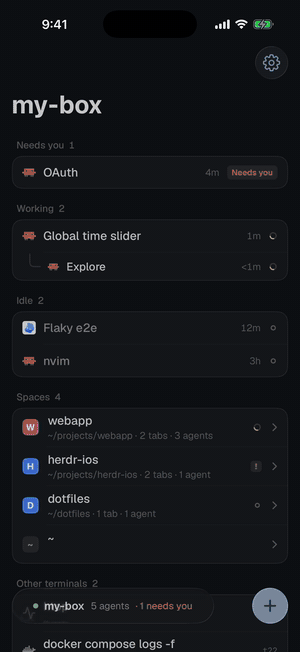
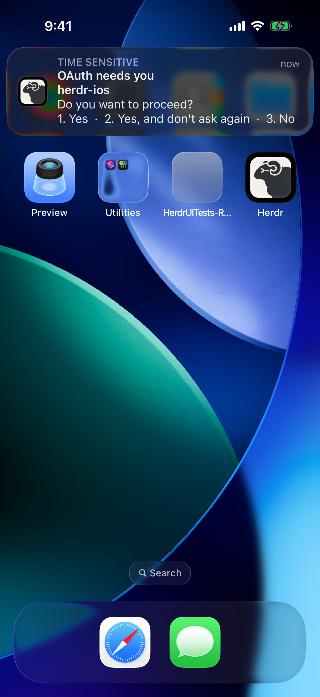
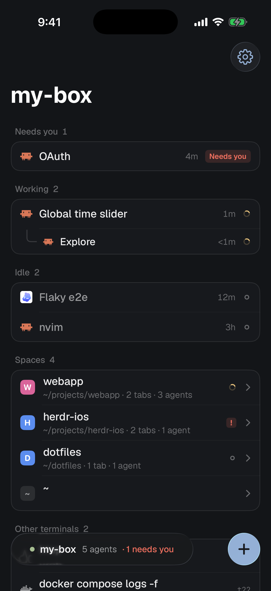
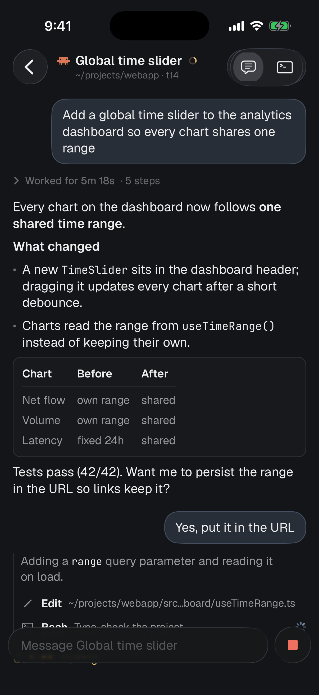
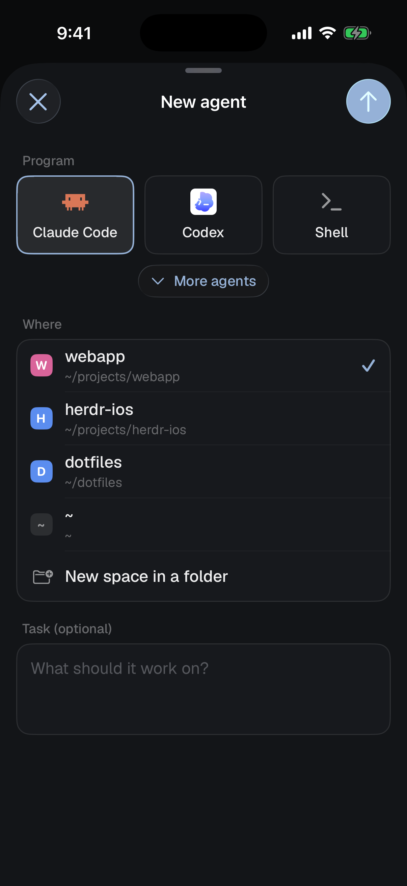
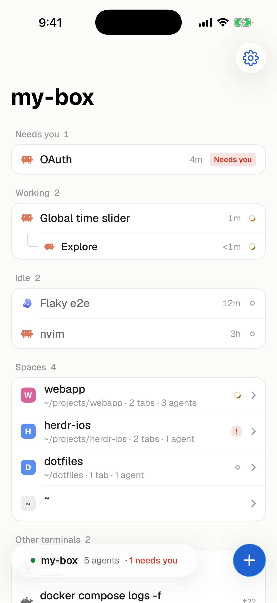
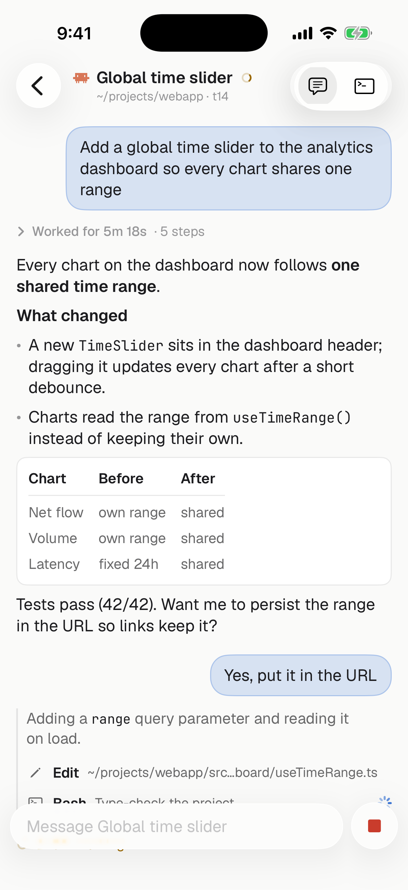

# herdr-pocket

この文書は `README.md` の日本語訳である。内容が食い違うときは英語版に従う。

[zzulanas/herdr-ios](https://github.com/zzulanas/herdr-ios) の fork であり、ファイルのプレビューを追加している。作業の規則は `AGENTS.md` にある。

[herdr](https://herdr.dev) のネイティブの iPhone・iPad クライアントである。どの coding agent が user の対応を待っているかを確認し、その agent の発言を読んで答え、稼働中の terminal を開ける。接続は素の SSH で行い、相手は user のマシンですでに動いている `herdr-core` である。

<p>


</p>
<p><a href="docs/demo.mp4">デモ動画の全編（MP4、53 秒）</a> · デモデータを iOS シミュレータで録画したもの</p>

<p>



</p>
<p>


</p>

## 機能

- **agent を、対応を待っている順に並べる。** マシン上のすべての agent を Needs you、Working、Done、Idle に分ける。分類には herdr 自身の状態の語と、「見ていないあいだに終わった」の判定規則を使う。sub-agent は親の agent の下に入れ子で表示する。
- **space と tab。** デスクトップアプリと同じ space、tab、pane を、herdr-core の `herdr-app` レイアウト文書から逐次読み込む。一方の画面で加えた変更は、もう一方の画面にも反映される。
- **Chat**（Claude Code と Codex）。agent の会話を、terminal ではなくネイティブのメッセージとして表示する。
  - プロンプトは吹き出しで、返答は表を含む整形済みのテキストで表示する。
  - 終わったターンは「Worked for 5m 18s · 12 steps」の下に折りたたむ。
  - 各ツール呼び出しは、タップできる 1 行で表示する。
  - ブロックされた agent のダイアログはボタンになる。
- **Files。** マシン上で、space の端末がいるフォルダ（space を作ったときのフォルダではなく、端末の現在のディレクトリ）を閲覧し、PDF、Word・Excel・PowerPoint の文書、画像（HEIC を含む）、テキストを iPhone 上の Quick Look で開く。Markdown は整形して表示する。HTML と SVG は、スクリプトとネットワークの読み込みを止めたうえで、画面の幅で表示する。256 MiB までのファイルを分割して読む。
- **Changes。** space の git の未 commit の変更を一覧にし、ファイルごとの diff を色分けして表示する。git はマシン上で読み取り専用で実行する。
- **Terminal。** 本物の terminal（SwiftTerm）である。既定ではデスクトップと同じサイズを映し、ピンチでズームできる。「Fit to phone」のトグルを使うと、代わりに iPhone の画面に合わせてサイズを変える。ガラス調のキーバーが esc、ctrl、矢印キー、^C を加え、入力欄からプロンプト全体を送れる。
- **新しい agent。** Claude Code、Codex、shell、または herdr の一覧にある任意のプログラムを起動する。起動先は既存の space か新しいフォルダで、最初のタスクを任意で指定できる。
- **通知。** 「OAuth needs you」（agent の質問と選択肢を含む）や「Refactor finished」を、アプリを閉じていても受け取れる。タップするとその agent を開く。通知は user のマシンから Apple へ直接送られ、間に relay は入らない。
- **mod。** user 自身の herdr の mod が iPhone 上で動く。小さな JavaScriptCore のホストが、mod の使う `herdr`、`gpui-kit`、`gpui-base` の API を実装し、mod の要素ツリーを SwiftUI で描画する。mod の `exec` 呼び出しはマシン上で実行する。ただし `open` とクリップボードへの書き込み（`pbcopy`）は iPhone 側で処理する。
- **herdr の外観。** Graphite と Paper のテーマ、Geist と JetBrains Mono のフォント、herdr の状態マークを使う。iOS 26 の Liquid Glass はクローム（画面の枠部分）にだけ使う。

## 接続の仕組み

アプリは user のマシンに SSH の exec チャネルを開き、`herdr-core connect` を実行する。これは、デスクトップアプリがリモートのマシンに使うのと同じ、フレーム化された JSON-RPC のストリームである（`ssh box hc connect`）。マシンに追加でインストールするものはなく、サーバも relay も介さない。

- **ペアリング:** マシンで `scripts/pair.sh` を実行する（qrencode のある devshell で）。スクリプトは iPhone 用の SSH の鍵を作り、`herdr-core connect` だけに使える鍵として `~/.ssh/authorized_keys` に登録し（`restrict,command=…`）、鍵・マシンのアドレス・host key を入れた QR コードを表示する。アプリでそれを読み取る（またはコードを貼る）。host key はコードから pin するので、fingerprint を見比べる手順は無い。マシンでは何も待ち受けず、常駐もしない。iPhone の登録を外すときは、その行を消す。
- **ペアリングを使わないログイン:** アプリは Ed25519 の鍵を Keychain の中に生成する。その公開鍵をマシンの `~/.ssh/authorized_keys` に追加する。オンボーディングの画面に、コピーできる 1 行のコマンドが表示される。パスワードや、貼り付けた秘密鍵でもログインできる。
- **host key:** 初回の接続では、アプリはログインの前に止まり、マシンの host key の fingerprint を表示する。user が承認すると、その host key を Keychain に pin する。ペアリングではこの手順を省く。コードが host key を持つためである。すでに pin された host key を、コードで置き換えることはない。
- **ネットワーク:** マシンは iPhone から到達できる必要がある。たとえば Tailscale を経由する。
- **Chat:** マシン上の Claude Code の transcript を、読み取り専用の短い `python3` スクリプトで読む。スクリプトは herdr-core の `machine.exec` を通して実行する。セッションは、terminal のプロセスツリーから `~/.claude/sessions` を介して特定する。transcript は末尾だけを読み、その後は新しく追加されたバイトだけを読む。そのため、大きな transcript でも負荷は小さい。 Codex では、terminal のプロセスが開いている rollout を読む。共有の app-server につながった Codex は rollout を開いていないので、terminal の title（thread の名前）とフォルダから、Codex の state のデータベースで thread を引く。起動したばかりの Codex は、最初のメッセージを送るまで rollout を持たない。
- **Chat を開くとき**は terminal に attach しない。そのため、デスクトップ側のサイズは何も変わらない。

## 通知

iOS はバックグラウンドでアプリの SSH 接続を閉じるため、iPhone は agent が待ち状態に入ったことを検知できない。代わりに user のマシンが通知を送る。
- **notifier:** `herdr-notify` は短い Python スクリプトであり、サービスとして動く（macOS では launchd の agent `dev.herdr.notify`、Linux では systemd の user サービス、どちらも無い環境では nohup で起動する）。`hc events` を追い、agent がブロックされるかターンを終えると、user の APNs 鍵を使って HTTP/2 で Apple へ push する。
- **iPhone の宛先:** アプリは、開いている接続を通して自身の push token をマシンの `~/.config/herdr-ios/devices/` に渡す。

設定には有料の Apple Developer アカウントが必要である。
1. developer.apple.com → Certificates, IDs & Profiles → Keys で、Apple Push Notifications service を有効にした APNs 鍵を作成する。
2. notifier をインストールする。方法は 2 つある。アプリから行う場合は Settings → Notifications → Set up on <machine> を開き、`.p8` を選ぶ。Mac から行う場合は次を実行する。
   ```sh
   scripts/install-notifier.sh <ssh host> AuthKey_XXXXXXXXXX.p8 <team id> <bundle id>
   ```
3. 接続した状態で Herdr を開き、通知を許可する。Settings → Notifications → Send a test で試験の通知を送る。

鍵は user のマシンの `~/.config/herdr-ios` に置かれ、user 本人だけが読める。sub-agent と素の shell は通知しない。何を通知するかは `~/.config/herdr-ios/notify.json`（`{"on": ["blocked", "done"]}`）で調整できる。

## ビルドと実行

要件:
- **Mac:** Xcode 26.2 以降と [XcodeGen](https://github.com/yonaskolb/XcodeGen) を入れた macOS。
- **iPhone:** iOS 26。
- **任意:** mod をバンドルするための [bun](https://bun.sh)。
- **user のマシン:** SSH で到達できる herdr-core 0.1.11 以降。Chat と Files には python3 が必要である。

```sh
git clone https://github.com/YosukeIida/herdr-pocket && cd herdr-pocket
cp Config/Local.example.xcconfig Config/Local.xcconfig   # your team id and bundle id
xcodegen generate
open Herdr.xcodeproj                                     # run the Herdr scheme
```

コマンドラインでのビルドには `-skipPackagePluginValidation`（SwiftTerm がビルドプラグインを含むため）と、Xcode の Metal Toolchain（`xcodebuild -downloadComponent MetalToolchain`。SwiftTerm が Metal シェーダを持つため）が必要である。シミュレータ向けには、Keychain が動くようにアドホック署名する。

```sh
xcodebuild build -project Herdr.xcodeproj -scheme Herdr -destination "platform=iOS Simulator,name=iPhone 18 Pro" \
  -skipPackagePluginValidation CODE_SIGN_IDENTITY=- CODE_SIGN_STYLE=Manual DEVELOPMENT_TEAM=
```

シミュレータは Mac 自身の sshd に接続する。sshd が Tailscale のアドレスだけを受け付ける設定なら、127.0.0.1 ではなく Mac の Tailscale の IP に接続する。

### 自分の mod

バンドルする mod を `Config/mods.txt` に 1 行に 1 つずつ書く。各行には `~/.config/herdr-app/mods` の中のフォルダ名を書き、デスクトップのレイアウトで使うブロック ID がフォルダ名と異なる場合は、その ID を続けて書く。

```
linear
prs
my-drawer drawer
```

ビルド前の手順で、これらの mod を bun で `App/Resources/Mods` にバンドルする。このフォルダは gitignore の対象であるため、各自が自分の mod を同梱して配布する。マシン固有の mod の `exec` の調整は `Config/host-local.js` に書く。このファイルも gitignore の対象である。

```js
herdrIOS.onExec((cmd, args, on) => ({ cmd, args }))
```

## 構成

```
Packages/HerdrKit     protocol and model (SwiftPM, platform-independent, unit-tested)
  HerdrClient         framing, JSON-RPC, terminal streams with credit, events
  Layout / Names      the herdr-app layout doc: parse and edit, keeping unknown fields
  herdr-probe         macOS CLI that speaks the protocol over `ssh <host>`
App/Sources
  Net                 Citadel SSH transport, Keychain key store, host-key pinning
  Store               AppStore: connection, live terminals and layout, attention, actions
  UI                  SwiftUI screens, theme, terminal (SwiftTerm)
  Chat                transcript reader and Chat view
  Mods                JavaScriptCore mod host and SwiftUI renderer
scripts/              mod bundling and a headless mod test
```

テスト:
- **プロトコルとモデル:** `cd Packages/HerdrKit && swift test`。
- **UI:** `HerdrUITests` ターゲットを、実際のマシンに対して watch-only モードで実行する。設定は `TEST_RUNNER_` の接頭辞を付けてテストランナーに渡す（例: `TEST_RUNNER_HERDR_DEBUG_KEY_PATH`）。`HERDR_DEBUG_KEY_PATH` は常に必要である。初回接続の承認には `HERDR_TEST_HOST`、`HERDR_TEST_USER`、`HERDR_TEST_HOST_FP`、Files には `HERDR_TEST_SPACE`、`HERDR_TEST_FILES_PATH`、`HERDR_TEST_FILES`、Chat には `HERDR_TEST_TERMINAL` を渡す。
- **デモデータ:** `HERDR_DEMO=1` を付けると偽のデータで起動する。上のスクリーンショットはこの方法で作成した。

## 状況

本アプリは初期段階である。実機の Linux マシン上の herdr-core 0.1.14 に対して試験している。既知の未対応点は次のとおりである。
- 共有の app-server につながった Codex のチャットは、thread を名前とフォルダで照合する。同じフォルダに同じ名前の thread が 2 つあると、取り違えうる。
- 通知から直接返答する機能（Yes/No）はまだ実装していない。タップすると agent を開く。
- herdr-core の中で追加したマシン（`hc machine add`）は、まだ閲覧できない。

## クレジット

- [herdr](https://herdr.dev) と [herdr-app](https://github.com/herdrdev/herdr-app) は [ogulcancelik](https://github.com/ogulcancelik) による。本アプリのアイコン、テーマ、プログラムのアイコンは herdr-app から取っている。
- Chat の画面は [Heeler](https://github.com/ZingerLittleBee/Heeler) を参考にした。
- サードパーティのライセンスは [NOTICE](NOTICE) を参照。

本アプリは herdr プロジェクトと提携しておらず、その承認も受けていない。

## ライセンス

[Apache-2.0](LICENSE)
