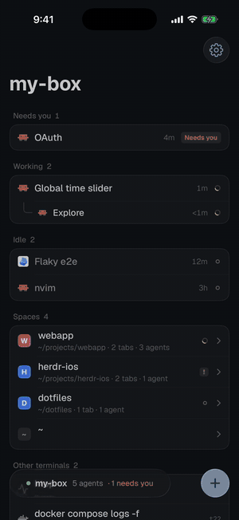
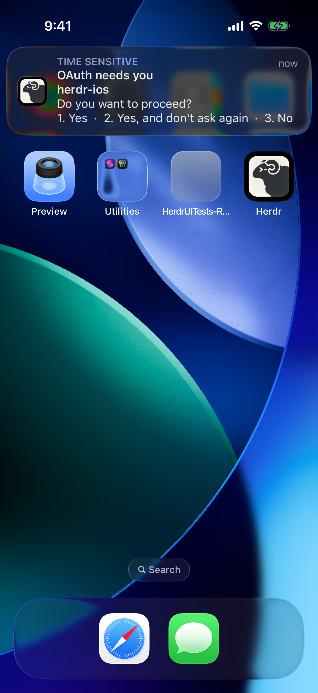
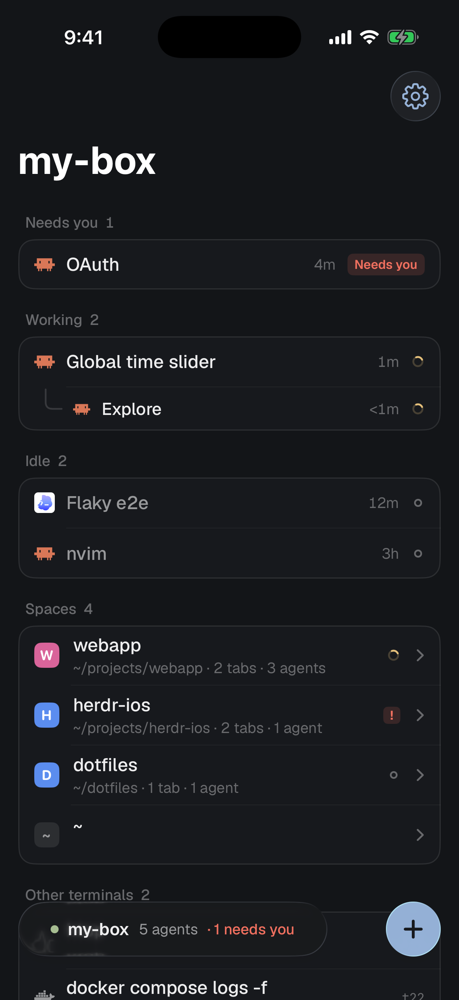
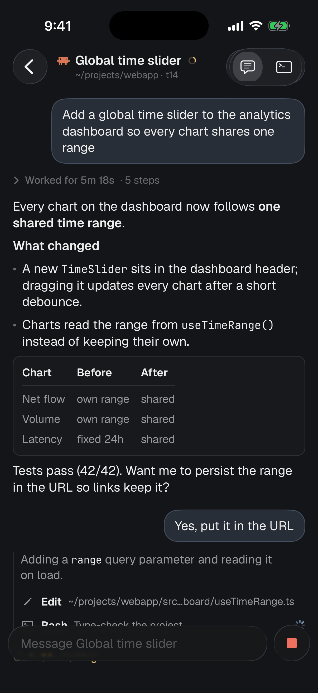
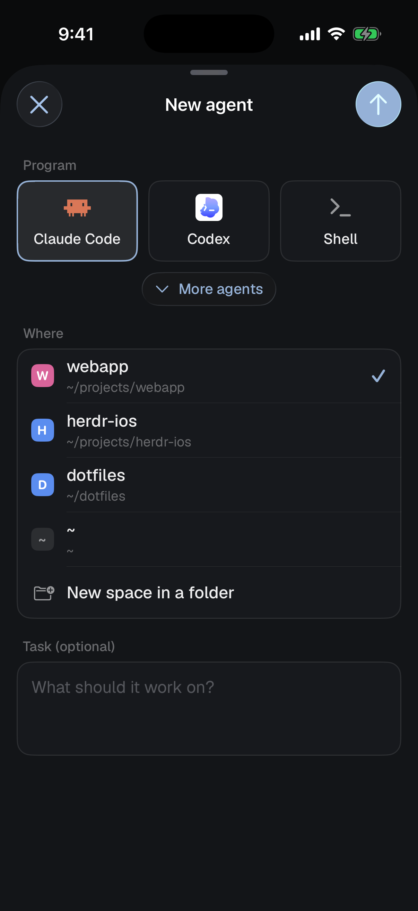
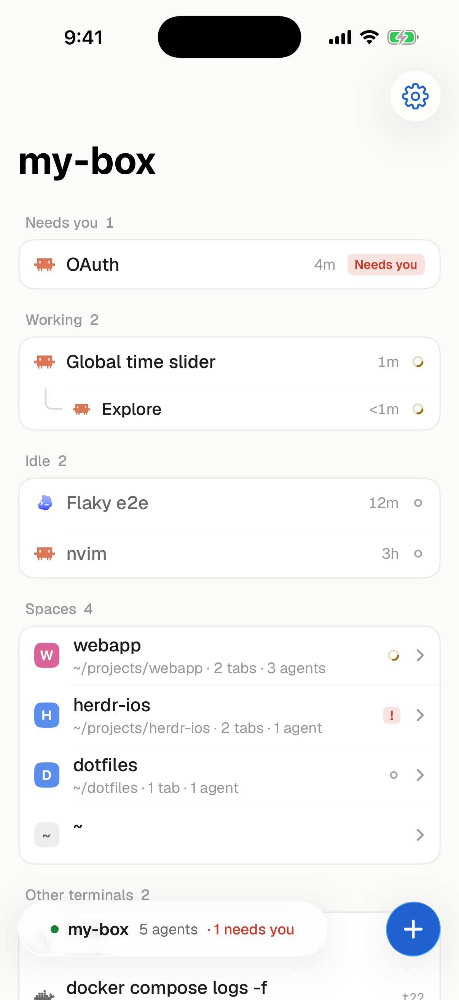
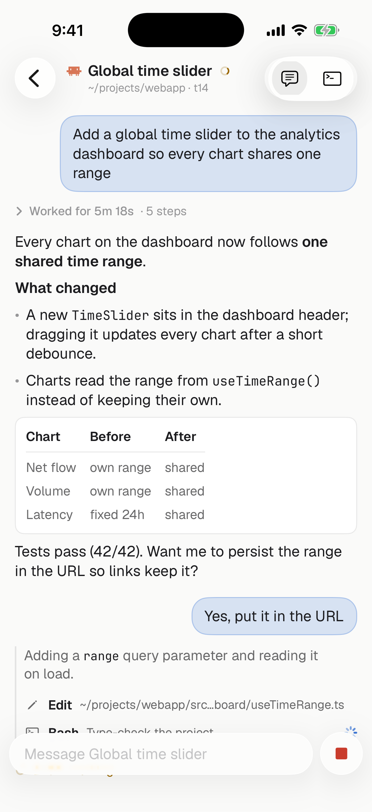

# Herdr for iOS (unofficial)

A native iPhone and iPad client for [herdr](https://herdr.dev). See which of your coding agents need you, read and answer them, and open their live terminals. It connects over plain SSH to the `herdr-core` already running on your machine.

<p>


</p>
<p><a href="docs/demo.mp4">Full demo video (MP4, 53 s)</a> · demo data, recorded in the iOS simulator</p>

<p>



</p>
<p>


</p>

## What it does

- **Agents, sorted by who needs you.** Every agent on the machine is grouped as Needs you, Working, Done or Idle, using herdr's own status words and "done while you weren't looking" rule. Sub-agents nest under their parent.
- **Spaces and tabs.** The same spaces, tabs and panes as the desktop app, read live from the core's `herdr-app` layout document. Changes you make on one screen show up on the other.
- **Chat** (Claude Code). An agent's conversation as native messages instead of a terminal:
  - prompts appear as bubbles, replies as formatted text with tables;
  - finished turns fold behind "Worked for 5m 18s · 12 steps";
  - each tool call is one tappable line;
  - a blocked agent's dialog becomes buttons.
- **Terminal.** The real terminal (SwiftTerm), mirroring the desktop size by default with pinch-to-zoom. A "Fit to phone" toggle resizes it to the phone instead. A glass key bar adds esc, ctrl, arrows and ^C, and a compose box sends whole prompts.
- **New agents.** Start Claude Code, Codex, a shell or any program from herdr's list, in an existing space or a new folder, with an optional first task.
- **Notifications.** Get "OAuth needs you" (with the agent's question and options) or "Refactor finished", even when the app is closed; tap to open that agent. Your machine sends them straight to Apple, with no relay in between.
- **Mods.** Your own herdr mods run on the phone. A small JavaScriptCore host implements the `herdr`, `gpui-kit` and `gpui-base` APIs they use and draws their element trees in SwiftUI. Their `exec` calls run on the box.
- **herdr's look.** It uses the Graphite and Paper themes, Geist and JetBrains Mono, and herdr's status marks, with iOS 26 Liquid Glass on the chrome only.

## How it connects

The app opens an SSH exec channel to your machine and runs `herdr-core connect`. That's the same framed JSON-RPC stream the desktop app uses for remote machines (`ssh box hc connect`). Nothing else needs to be installed on the machine, and no server or relay is involved.

- **Login:** the app generates an Ed25519 key in the Keychain. Add its public key to the box's `~/.ssh/authorized_keys`; onboarding shows a copyable one-liner. A password or a pasted private key also works.
- **Host key:** the box's host key is pinned on first connect.
- **Network:** the box has to be reachable from the phone, for example over Tailscale.
- **Chat:** reads Claude Code's transcript on the box with a short read-only `python3` script, run through the core's `machine.exec`. It finds the session from the terminal's process tree via `~/.claude/sessions`. It reads only the tail of the transcript, then new bytes, so large transcripts stay cheap.
- **Opening Chat** never attaches to the terminal, so it doesn't resize anything on your desktop.

## Notifications

iOS closes the app's SSH connection in the background, so the phone can't see an agent start waiting. Your machine sends the notification instead:
- **The notifier:** `herdr-notify` is a short Python script running as a systemd user service. It follows `hc events` and, when an agent becomes blocked or finishes a turn, pushes to Apple over HTTP/2 with your APNs key.
- **Your phone's address:** the app hands its push token to the machine over the open connection, in `~/.config/herdr-ios/devices/`.

Setup needs a paid Apple Developer account:
1. Create an APNs key at developer.apple.com → Certificates, IDs & Profiles → Keys, with Apple Push Notifications service enabled.
2. Install the notifier, either from the app (Settings → Notifications → Set up on <machine>, then choose the `.p8`) or from your Mac:
   ```sh
   scripts/install-notifier.sh <ssh host> AuthKey_XXXXXXXXXX.p8 <team id> <bundle id>
   ```
3. Open Herdr while connected and allow notifications. Settings → Notifications → Send a test.

The key stays on your machine in `~/.config/herdr-ios`, readable only by you. Sub-agents and plain shells don't notify, and you can tune what does in `~/.config/herdr-ios/notify.json` (`{"on": ["blocked", "done"]}`).

## Build and run

Requirements:
- **Mac:** macOS with Xcode 26.2+ and [XcodeGen](https://github.com/yonaskolb/XcodeGen).
- **Phone:** iOS 26.
- **Optional:** [bun](https://bun.sh), to bundle your mods.
- **Your machine:** herdr-core 0.1.11+, reachable over SSH; python3 for Chat.

```sh
git clone https://github.com/zzulanas/herdr-ios && cd herdr-ios
cp Config/Local.example.xcconfig Config/Local.xcconfig   # your team id and bundle id
xcodegen generate
open Herdr.xcodeproj                                     # run the Herdr scheme
```

Command-line builds need `-skipPackagePluginValidation` (SwiftTerm ships a build plugin).

### Your mods

List the mods to bundle in `Config/mods.txt`, one per line. Each line has the folder name in `~/.config/herdr-app/mods`, plus the block id it uses in the desktop layout if that differs from the name:

```
linear
prs
my-drawer drawer
```

The pre-build step bundles them with bun into `App/Resources/Mods`. That folder is gitignored, so each person ships their own mods. Machine-specific tweaks to a mod's `exec` go in `Config/host-local.js`, also gitignored:

```js
herdrIOS.onExec((cmd, args, on) => ({ cmd, args }))
```

## Layout

```
Packages/HerdrKit     protocol and model (SwiftPM, platform-independent, unit-tested)
  HerdrClient         framing, JSON-RPC, terminal streams with credit, events
  Layout / Names      the herdr-app layout doc: parse and edit, keeping unknown fields
  herdr-probe         macOS CLI that speaks the protocol over `ssh <host>`
App/Sources
  Net                 Citadel SSH transport, Keychain key store, host-key pinning
  Store               AppStore: connection, live terminals and layout, attention, actions
  UI                  SwiftUI screens, theme, terminal (SwiftTerm)
  Chat                transcript reader and Chat view
  Mods                JavaScriptCore mod host and SwiftUI renderer
scripts/              mod bundling and a headless mod test
```

Tests:
- **Protocol and model:** `cd Packages/HerdrKit && swift test`.
- **UI:** run the `HerdrUITests` target against a real box in watch-only mode. Set `HERDR_DEBUG_KEY_PATH` and `HERDR_TEST_TERMINAL`.
- **Demo data:** `HERDR_DEMO=1` launches with fake data, which is how these screenshots were made.

## Status

This is early. It's tested against herdr-core 0.1.14 on a real Linux machine. Known gaps:
- Chat covers Claude Code only.
- Replying straight from a notification (Yes/No) isn't built yet; tapping opens the agent.
- Machines added inside herdr-core (`hc machine add`) aren't browsable yet.

## Credits

- [herdr](https://herdr.dev) and [herdr-app](https://github.com/herdrdev/herdr-app) by [ogulcancelik](https://github.com/ogulcancelik); this app's icon, themes and program icons come from herdr-app.
- The Chat view was inspired by [Heeler](https://github.com/ZingerLittleBee/Heeler).
- See [NOTICE](NOTICE) for third-party licenses.

Not affiliated with or endorsed by the herdr project.

## License

[Apache-2.0](LICENSE)
